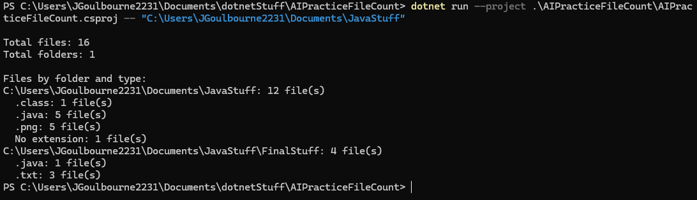
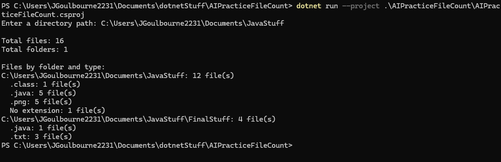

# AIPracticeFileCount

AIPracticeFileCount is a .NET 10 console application that scans a directory and its
subdirectories and reports information about the files it finds.

The application reports:

- The total number of files
- The total number of subdirectories
- Files grouped by folder
- Files grouped by extension within each folder
- Folders that could not be accessed

## Prerequisites

- .NET 10 SDK

## Build

From the repository root, restore dependencies and build the solution:

```powershell
dotnet restore .\AIPracticeFileCount.slnx
dotnet build .\AIPracticeFileCount.slnx
```

## Usage

The directory can be provided as a command-line argument:

```powershell
dotnet run --project .\AIPracticeFileCount\AIPracticeFileCount.csproj -- "C:\Path\To\Directory"
```

If no path is provided, the application prompts you to enter one:

```powershell
dotnet run --project .\AIPracticeFileCount\AIPracticeFileCount.csproj
```

## Screenshots



